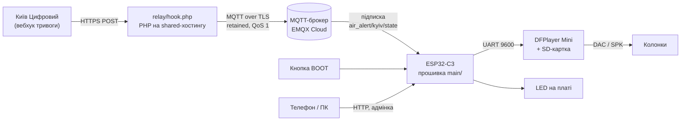

# air_alert — сповіщувач повітряної тривоги для Києва

Невеликий пристрій на **ESP32-C3 SuperMini** і **DFPlayer Mini**: коли в
Києві починається повітряна тривога, він вмикає сирену через колонки, на
відбій грає окрему мелодію, а щодня о 09:00 вмикає хвилину мовчання.
Телефон для цього не потрібен. Стан видно на світлодіоді, а налаштування
задаються у вбудованій веб-адмінці, без перепрошивки.

Пристрій розрахований на будівлю, де тривогу мають почути всі, зокрема
дитячий садочок: є розклад гучності, журнал тривог за 7 днів, а кнопка
на платі зупиняє звук.

## Як це працює



1. Портал «Київ Цифровий» надсилає вебхук на початку і в кінці тривоги.
2. Ретранслятор `relay/` (PHP, звичайний хостинг) перевіряє секрет і
   визначає рівень: `RED` (ракети, балістика, масована атака дронів, тип
   невідомий), `YELLOW` (дрони) або `CLEAR` (відбій). Потім публікує
   retained-повідомлення в MQTT-брокер.
3. Плата тримає лише **вихідне** з'єднання з брокером, тому публічний IP
   і проброс портів не потрібні. Після перезавантаження чи втрати Wi-Fi
   вона одразу отримує поточний стан завдяки retained-повідомленню.
4. Плата реагує на зміну стану: звук, LED, запис у журнал.

Формат повідомлення в топіку `air_alert/kyiv/state`:

```json
{"state": "RED", "ts": 1763740800, "src": "kyiv_webhook"}
```

## Залізо

| Компонент | Примітка |
|---|---|
| ESP32-C3 SuperMini | 4 МБ flash, native USB, вбудований LED і кнопка BOOT |
| DFPlayer Mini (HW-247) | MP3-плеєр з SD-слотом |
| microSD-картка | FAT32, до 32 ГБ |
| Резистор 1 кОм | у лінію ESP TX → DFPlayer RX |
| Активні колонки (з підсилювачем) | на вихід DAC; або пасивний динамік до 3 Вт на SPK |
| USB-кабель і блок живлення 5 В | живить і плату, і DFPlayer |

## Підключення

```
 ESP32-C3 SuperMini                     DFPlayer Mini
 ┌──────────────┐                     ┌──────────────┐
 │           5V ├─────────────────────┤ VCC          │
 │          GND ├─────────────────────┤ GND          │
 │ GPIO1 (TX)   ├───[ 1 кОм ]─────────┤ RX           │
 │ GPIO0 (RX)   ├─────────────────────┤ TX           │
 │              │                     │              │
 │ GPIO8  LED   │  (вбудований)       │ DAC_L ───────┼──► лівий канал колонок
 │ GPIO9  BOOT  │  (вбудована кнопка) │ DAC_R ───────┼──► правий канал колонок
 └──────────────┘                     │ GND ─────────┼──► земля колонок
                                      │              │
                                      │ SPK_1/SPK_2 ─┼──► або пасивний динамік
                                      └──────────────┘
```

| Що | GPIO ESP32-C3 | Куди | Примітка |
|---|---|---|---|
| UART TX | 1 | DFPlayer **RX** | обов'язково через 1 кОм, інакше в динаміку чути шум |
| UART RX | 0 | DFPlayer **TX** | |
| Живлення | 5V | DFPlayer **VCC** | від USB (5 В дає плеєру запас під гучний звук) |
| Земля | GND | DFPlayer **GND** | спільна земля, зокрема з колонками |
| LED | 8 | вбудований | active-low (0 = світить) |
| Кнопка | 9 | вбудована BOOT | єдина кнопка керування |

GPIO 18/19 зайняті USB, їх не чіпати. Усі піни можна змінити в
`idf.py menuconfig` → **Air Alert → Pins**.

## SD-картка

DFPlayer грає трек за **порядком запису** файлів у FAT, а не за іменем.
Відформатуйте картку у FAT32 і копіюйте файли **по одному**, саме в
такому порядку:

| Трек | Файл | Коли грає |
|---|---|---|
| 1 | `air-alerts.mp3` | початок тривоги (RED і YELLOW), BOOT двічі |
| 2 | `chervonyi_mak.mp3` | відбій, BOOT утримання 2 с |
| 3 | `silence_himn.mp3` | щодня о 09:00:00 за Києвом, хвилина мовчання |

Перевірити порядок на Linux: `ls -U /media/$USER/<картка>`. Звукових
файлів у репозиторії немає (окрім синтезованих запасних у `sounds/`),
підготуйте свої.

## Збірка та прошивка

Потрібен [ESP-IDF](https://docs.espressif.com/projects/esp-idf/) v6.1.

```bash
. ~/esp/esp-idf/export.sh              # один раз на термінал
idf.py menuconfig                      # розділ "Air Alert" (необов'язково)
idf.py build
idf.py -p /dev/ttyACM0 flash monitor   # Ctrl+] — вихід з монітора
make -C tests/host test                # хост-тести чистої логіки
```

Якщо порт `/dev/ttyACM0` не з'являється: затисніть BOOT, натисніть RESET,
відпустіть BOOT (режим прошивки). Користувач має бути в групі `dialout`.

У `menuconfig` задаються значення за замовчуванням: Wi-Fi, MQTT, піни,
гучність, кількість повторів сирени, пороги. Те, що збережено через
адмінку, має пріоритет.

## Перший запуск

1. Без налаштованого Wi-Fi плата піднімає точку доступу
   `air-alert-xxxxxx` (пароль `airalert1`), LED швидко блимає.
2. Підключіться до неї з телефона: сторінка налаштування відкриється сама
   (або відкрийте `http://192.168.4.1`).
3. Введіть Wi-Fi, логін і пароль MQTT-брокера та натисніть «Зберегти».
   Плата перезавантажиться і підключиться до вашої мережі.

## Логіка роботи

### Стани

| Стан | Що означає |
|---|---|
| `UNKNOWN` | щойно увімкнулась, стану від брокера ще немає |
| `RED` | повітряна тривога (ракети, балістика, масовані дрони, тип невідомий) |
| `YELLOW` | загроза дронів |
| `CLEAR` | відбій |

Стан змінює брокер або кнопка BOOT (локально). Локальна зміна в брокер
не надсилається, тож наступне повідомлення від брокера поверне реальний
стан.

### Звук і світлодіод

| Подія | Звук | LED |
|---|---|---|
| Повітряна тривога (RED) | трек 1 (повторів: `AA_SIREN_REPEATS`) | світить постійно |
| Загроза дронів (YELLOW) | трек 1 один раз | блимає раз на секунду |
| Відбій (CLEAR) | трек 2 | не світить |
| 09:00 щодня | трек 3 | — |
| Брокер недоступний > 60 с | — | блимає раз на 2 с |
| Точка доступу (налаштування) / DFPlayer не відповідає | — | блимає швидко (2 Гц) |

LED працює завжди, навіть коли гучність 0.

### Хто кого перериває

| Зараз грає ↓ / Подія → | Тривога | Відбій | 09:00 |
|---|---|---|---|
| Тривога | — | перериває | після тривоги |
| Відбій | перериває | — | після відбою |
| Хвилина мовчання | перериває | після гімну | — |

«Після…» означає, що звук зіграє, щойно закінчиться поточний.
Запам'ятовується лише останній відкладений звук, і кнопка BOOT скасовує
його теж. Стан, LED і журнал оновлюються одразу.

### Увімкнення під час тривоги

- Якщо зараз відбій, плата при старті нічого не грає.
- Якщо тривога почалась менше ніж 3 години тому (`AA_STALE_ALERT_SEC`),
  сирена грає один раз.
- Якщо тривога старіша (наприклад, вебхук відбою загубився), горить
  лише LED, без сирени.
- Поки час ще не синхронізовано, сирена грає завжди: краще зайва
  сирена, ніж пропущена.

### Хвилина мовчання

Час береться з SNTP при кожному старті (TZ `Europe/Kyiv`). Щодня о
09:00:00 грає трек 3. Поки час не синхронізовано, хвилина мовчання не
планується. Вимикається в `menuconfig` (`AA_SILENCE_ENABLE`).

### Гучність

Гучність (0–30) обирається перед кожним відтворенням і раз на хвилину
під час нього, за розкладом: дні тижня, час від–до, гучність. Якщо
збігається кілька записів, діє найтихіший. Поза розкладом і поки час не
синхронізовано діє гучність за замовчуванням. Розклад зберігається у
флеші. Редагування розкладу в адмінці ще в розробці
(`docs/superpowers/plans/2026-11-22-volume-schedule.md`).

## Кнопка BOOT

| Дія | Що робить |
|---|---|
| Будь-яке натискання, поки грає звук | лише зупиняє звук (стан не змінюється) |
| Двічі швидко, коли тихо | «Тривога» (локально) |
| Утримати 2 с, коли тихо | «Відбій» (локально) |
| Увімкнути/RESET, потім протягом 2 с затиснути BOOT на 5 с | скинути налаштування (поки тримаєте, LED швидко блимає) |

Не затискайте BOOT ще до увімкнення: тоді плата стартує в режимі прошивки.

## Адмінка

`http://<IP плати>/`, логін `admin`, пароль за замовчуванням `admin`
(змініть його на сторінці). IP видно в лозі монітора (`got ip ...`) або в
роутері.

- Стан: тривога / загроза дронів / відбій, Wi-Fi, MQTT, час.
- Налаштування Wi-Fi, MQTT, пароль адмінки. Порожнє поле пароля означає
  «не змінювати».
- «Журнал за 7 днів»: початок, кінець, тривалість, рівень, джерело
  (брокер чи кнопка). Зберігається у флеші, переживає вимкнення.
- «Тест: тривога / відбій / 09:00»: програти трек.
- «Скинути налаштування».

Стан у JSON: `curl -u admin:PASS http://<IP>/status`.

## Ретранслятор

PHP-скрипт для звичайного shared-хостингу, без composer і демонів.
Розгортання, реєстрація вебхука в «Київ Цифровому» і чекліст перевірки
описані в [`relay/README.md`](relay/README.md). Секрети лежать у
`relay/config.php`, який не комітиться (зразок:
`relay/config.example.php`).

## Перевірка без вебхука

Публікація стану в брокер (retained, як це робить ретранслятор):

```bash
mosquitto_pub -h HOST -p 8883 --capath /etc/ssl/certs -u USER -P PASS \
  -t air_alert/kyiv/state -r -m "{\"state\":\"RED\",\"ts\":$(date +%s),\"src\":\"manual\"}"
```

Увага: `-r` перезаписує справжній збережений стан для всіх плат. Для тесту
без цього приберіть `-r`.

## Структура репозиторію

```
main/            прошивка, по модулю на пару .c/.h
  main.c           NVS + старт модулів
  alert_state.*    стан CLEAR/YELLOW/RED/UNKNOWN + callback на зміну
  wifi.*           STA з автореконектом, AP для налаштування
  admin.*          веб-адмінка (esp_http_server), сторінка в admin_page.h
  dns_server.*     captive portal у режимі AP
  mqtt.*           esp-mqtt поверх TLS, підписка на стан
  notify.*         окрема задача: DFPlayer, LED, кнопка, пріоритети звуків
  button*.c        розпізнавання жестів кнопки BOOT
  dfplayer.*       драйвер DFPlayer Mini
  clock.*          SNTP, час за Києвом
  silence.*        хвилина мовчання о 09:00
  volume.*         розклад гучності
  alert_log.*      журнал тривог за 7 днів у флеші
  settings.*       налаштування в NVS, дефолти з Kconfig
  Kconfig.projbuild  усі піни й параметри (menuconfig → Air Alert)
tests/host/      хост-тести чистої логіки (без плати)
relay/           PHP-ретранслятор вебхук → MQTT
docs/superpowers/ проєктні рішення (specs) і плани реалізації (plans)
sounds/          синтезовані запасні звуки
```

Проєктне рішення з обґрунтуванням вибору архітектури:
[`docs/superpowers/specs/2026-11-21-air-alert-mqtt-design.md`](docs/superpowers/specs/2026-11-21-air-alert-mqtt-design.md).
